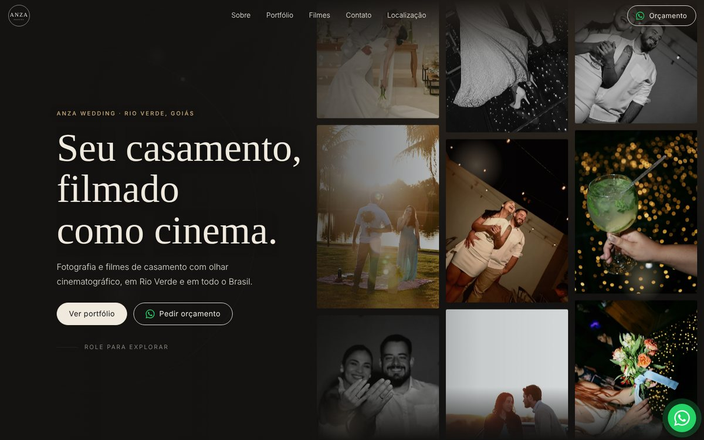
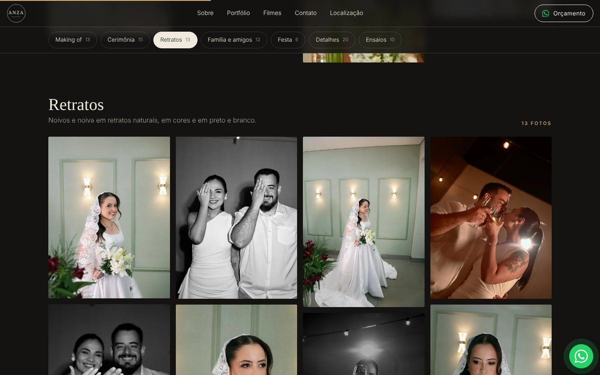

# anza_audiovisual
Site institucional da ANZA Wedding, produtora de fotos e filmes de casamento em Rio Verde, GO. Portfólio por nicho com lightbox, seção de filmes no YouTube, contato via WhatsApp, mapa e LGPD. HTML, CSS e JavaScript puros, responsivo (PC e celular).

## Prévia






<p>
  
  
</p>

## O que tem no site

- **Portfólio por nicho (89 fotos):** Making of, Cerimônia, Retratos, Família e amigos, Festa, Detalhes e Ensaios, com menu fixo e lightbox (setas, teclado e deslize no celular).
- **Imagens otimizadas:** cada foto em 480w e 800w (WebP) e o original em JPEG (`srcset`), com carregamento preguiçoso e placeholder.
- **Topo animado:** colunas de fotos no PC e apresentação em tela cheia no celular. Vídeo opcional pela variável `CFG.video` no script.
- **Animações ao rolar e nas opções:** textos e fotos que entram por lados diferentes, cartas que se revelam em máscara e inclinam com o mouse, contadores de fotos, parallax no topo, faixa que acelera com a rolagem, menu de nichos com seletor deslizante, ondas nos cliques, menu do celular em cascata, zoom na foto ampliada e pontos de navegação laterais. Tudo é desligado com `prefers-reduced-motion`.
- **Filmes:** seção do YouTube com fotos passando ao fundo.
- **Contato:** formulário validado e sanitizado no navegador, que abre o WhatsApp com a mensagem pronta (nada é guardado).
- **Localização:** mapa ilustrativo de Rio Verde, Goiás, com atalhos para o Google Maps.
- **Redes:** Instagram, YouTube e WhatsApp com os ícones oficiais.
- **LGPD:** aviso de cookies com aceitar/recusar; o formulário não guarda nada.
- **Segurança reforçada:** CSP estrita por hash com Trusted Types, só links permitidos, formulário com travas contra robôs (isca, tempo, limite por hora, higienização do texto), proteção contra o site ser embutido em outras páginas, fotos sem arrastar nem menu de contexto. Detalhes e limites em [SECURITY.md](SECURITY.md).
- **Tela travada no celular:** a página não arrasta para os lados nem tem efeito elástico.
- **Acessibilidade:** navegação por teclado, `prefers-reduced-motion` e textos alternativos nas fotos.

## Estrutura

```
index.html   página única (HTML, CSS e JavaScript)
img/         fotos otimizadas (480w, 800w e original), nomeadas por nicho: making-of-1, cerimonia-1...
thumb.jpg    imagem de compartilhamento (og:image)
docs/        imagens de prévia usadas neste README
_headers     CSP, X-Frame-Options e demais cabeçalhos (Netlify / Cloudflare Pages)
vercel.json  os mesmos cabeçalhos para a Vercel
SECURITY.md  como o site se protege, limites e checklist de quem administra
tools/       atualizar-csp.py: recalcula os hashes da CSP depois de editar o JS ou o CSS
.well-known/ security.txt (contato para relatar falhas)
.nojekyll    para o GitHub Pages servir todos os arquivos
```

## Como colocar no ar

- **GitHub Pages:** Settings > Pages > Deploy from a branch > `main` / `(root)`. (Esse serviço ignora o `_headers`.)
- **Netlify ou Cloudflare Pages (recomendado):** conecte este repositório ou arraste a pasta. O `_headers` já aplica todos os cabeçalhos de segurança.
- **Vercel:** importe o repositório. O `vercel.json` aplica os cabeçalhos.
- **Hospedagem comum (Hostinger etc.):** envie `index.html` e a pasta `img` para o `public_html`.

Para testar localmente: `python3 -m http.server 8000` e abra http://localhost:8000.

## O que editar

- **Contatos:** procure `5564981025380` (WhatsApp), `instagram.com/anza.wedding` e `youtube.com/@anzaaudiovisual` no `index.html`. Troque também a lista de links permitidos (seção 16 do script), senão o novo link será bloqueado de propósito.
- **Depois de editar o JS ou o CSS do `index.html`:** rode `python3 tools/atualizar-csp.py` para atualizar os hashes da CSP.
- **Vídeo do topo:** no script, em `CFG`, preencha `video:"caminho.mp4"` (MP4 curto e leve).
- **Fotos:** troque os arquivos de `img/` mantendo os nomes e os tamanhos (480w, 800w e original).

## Créditos

© 2026 ANZA - Todos os direitos reservados. As fotos pertencem à ANZA Wedding.

Desenvolvido por [Matheus Medeiros](https://github.com/matheus1906-hash).
