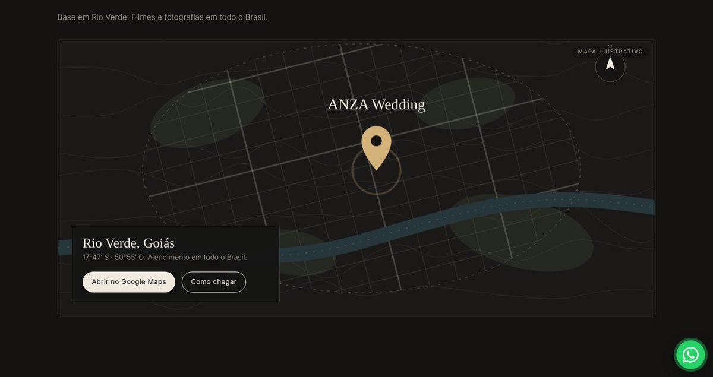
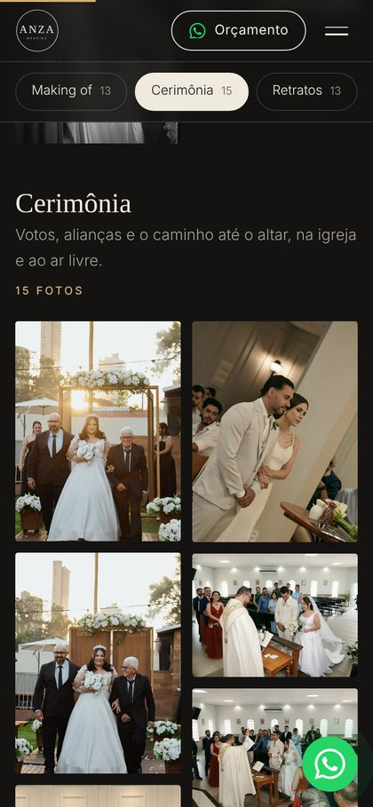

# anza_audiovisual
Site institucional da ANZA Wedding, produtora de fotos e filmes de casamento em Rio Verde, GO. Portfólio por nicho com lightbox, seção de filmes no YouTube, contato via WhatsApp, mapa e LGPD. HTML, CSS e JavaScript puros, responsivo (PC e celular).

## Prévia




<p>
  
  
</p>

## O que tem no site

- **Portfólio por nicho (89 fotos):** Making of, Cerimônia, Retratos, Família e amigos, Festa, Detalhes e Ensaios, com menu fixo e lightbox (setas, teclado e deslize no celular).
- **Imagens otimizadas:** cada foto em 480w e 800w (WebP) e o original em JPEG (`srcset`), com carregamento preguiçoso e placeholder.
- **Topo animado:** colunas de fotos no PC e apresentação em tela cheia no celular. Vídeo opcional pela variável `CFG.video` no script.
- **Logo:** disco claro com ANZA em preto e o floreio sob o Z, em SVG (nítida em qualquer tamanho), no menu, na abertura e no rodapé.
- **Animações ao rolar e nas opções:** textos e fotos que entram por lados diferentes, cartas que se revelam em máscara e inclinam com o mouse, contadores de fotos, parallax no topo, faixa que acelera com a rolagem, menu de nichos com seletor deslizante, ondas nos cliques, menu do celular em cascata, zoom na foto ampliada e pontos de navegação laterais. Tudo é desligado com `prefers-reduced-motion`.
- **Filmes:** seção do YouTube com fotos passando ao fundo.
- **Contato:** formulário validado e sanitizado no navegador, que abre o WhatsApp com a mensagem pronta (nada é guardado).
- **Localização:** mapa ilustrativo de Rio Verde, Goiás, com atalhos para o Google Maps.
- **Redes:** Instagram, YouTube e WhatsApp com os ícones oficiais.
- **LGPD:** aviso de cookies com aceitar/recusar; o formulário não guarda nada.
- **Segurança reforçada:** CSP estrita por hash com Trusted Types, só links permitidos, formulário com travas contra robôs (isca, tempo, limite por hora, higienização do texto), proteção contra o site ser embutido em outras páginas, fotos sem arrastar nem menu de contexto. Detalhes e limites em [SECURITY.md](SECURITY.md).
- **Tela travada no celular:** a página não arrasta para os lados nem tem efeito elástico.
- **Painel de manutenção (`/admin`):** área restrita à dona e ao desenvolvedor, com login por código no e-mail (Cloudflare Access) e segunda trava no servidor. Liga o modo manutenção, publica um aviso no topo, troca WhatsApp/Instagram/YouTube e oculta fotos do portfólio, com histórico de quem mudou o quê. Visitantes não veem nenhuma opção de painel. Guia em [ADMIN.md](ADMIN.md).
- **Acessibilidade:** navegação por teclado, `prefers-reduced-motion` e textos alternativos nas fotos.

## Estrutura

```
index.html      página única do site (HTML, CSS e JavaScript)
img/            fotos otimizadas (480w, 800w e original), nomeadas por nicho: making-of-1, cerimonia-1...
thumb.jpg       imagem de compartilhamento (og:image)
admin/          painel de manutenção (HTML, CSS e JS externos) e a lista de fotos
functions/      servidor do painel e da configuração (Cloudflare Pages Functions)
tests/          38 testes das funções: npm test
_headers        CSP, X-Frame-Options e demais cabeçalhos (Cloudflare Pages / Netlify)
_routes.json    quais caminhos passam pelas funções
vercel.json     build (só o site), pasta de saída e cabeçalhos para a Vercel
ADMIN.md        como instalar e usar o painel (Cloudflare Access, KV, variáveis)
SECURITY.md     como o site e o painel se protegem, limites e checklist de quem administra
tools/          atualizar-csp.py (hashes da CSP), build-pages.mjs (monta dist/) e dev-server.mjs (teste local)
docs/           imagens de prévia usadas neste README
.well-known/    security.txt (contato para relatar falhas)
.nojekyll       para o GitHub Pages servir todos os arquivos
```

## Como colocar no ar

- **Cloudflare Pages (recomendado, necessário para o painel):** conecte este repositório com *Build command* `node tools/build-pages.mjs` e *Build output directory* `dist`. O `_headers` aplica os cabeçalhos de segurança. Para o painel, siga o passo a passo do [ADMIN.md](ADMIN.md).
- **GitHub Pages:** Settings > Pages > Deploy from a branch > `main` / `(root)`. O site público funciona, mas o `_headers` é ignorado e o painel não existe.
- **Netlify:** conecte o repositório. O `_headers` aplica os cabeçalhos; o painel não funciona.
- **Vercel:** importe o repositório e deixe as configurações como estão: o `vercel.json` já define o comando de build (`node tools/build-pages.mjs --public-only`), a pasta de saída (`dist`) e os cabeçalhos. Publica só o site, sem o painel.
- **Hospedagem comum (Hostinger etc.):** envie `index.html` e a pasta `img` para o `public_html`.

Para testar só o site: `python3 -m http.server 8000` e abra http://localhost:8000. Para testar o site com o painel (Access simulado): `npm run dev` e abra http://127.0.0.1:8788 (veja o [ADMIN.md](ADMIN.md)).

## O que editar

- **Contatos:** pelo painel (aba *Contatos*), sem mexer no código. O `index.html` guarda os valores originais (WhatsApp `5564981025380`, `instagram.com/anza.wedding`, `youtube.com/@anzaaudiovisual`) e a lista de links permitidos (seção 16 do script); os valores do painel prevalecem quando o servidor estiver no ar.
- **Depois de editar o JS ou o CSS do `index.html`:** rode `python3 tools/atualizar-csp.py` para atualizar os hashes da CSP.
- **Rolagem do mouse e do touchpad:** em `CFG.scroll` (no script do `index.html`): `speed` é a distância por giro da roda (1 = padrão do navegador; hoje 0,6) e `glide` é o tempo de deslize em segundos (hoje 0,22). Vale só para mouse/touchpad; toque, teclado e links ficam nativos, e `prefers-reduced-motion` desliga o efeito. Depois de editar, rode `python3 tools/atualizar-csp.py`.
- **Vídeo do topo:** no script, em `CFG`, preencha `video:"caminho.mp4"` (MP4 curto e leve).
- **Fotos:** troque os arquivos de `img/` mantendo os nomes e os tamanhos (480w, 800w e original).

## Créditos

© 2026 ANZA - Todos os direitos reservados. As fotos pertencem à ANZA Wedding.

Desenvolvido por [Matheus Medeiros](https://github.com/matheus1906-hash).
